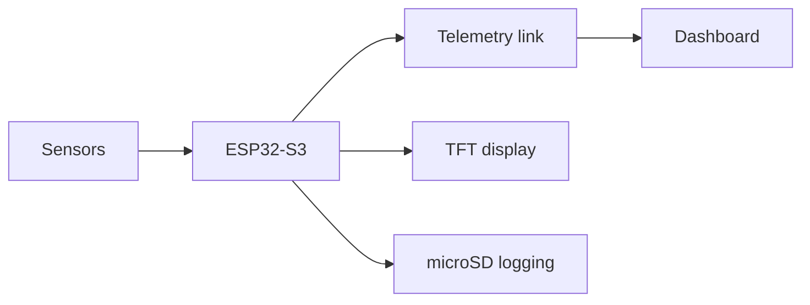

# ESP32-S3 Instrumentation Board and Telemetry Prototype

Schematic, PCB layout and a simulated telemetry prototype for a hydrogen fuel cell vehicle built for Shell Eco-marathon by the Antasena ITS Research Team.

## My Role

Electronics &amp; Powertrain Intern, Antasena ITS Research Team, Jul – Aug 2026.

## What I Did

- Designed the schematic and PCB layout (EasyEDA) for an ESP32-S3 instrumentation board with microSD logging, a TFT display and multi-channel sensor interfaces.
- Self-taught C++ in 5 days, then built a simulated telemetry prototype (Wokwi, PlatformIO) showing distance, speed, time and driving strategy in the next 5.

## System Overview

## Tech Stack

- ESP32-S3
- EasyEDA
- C++
- PlatformIO
- Wokwi
- VS Code

## Prototype Scope

- Telemetry link between an ESP32-S3 and a laptop (pit station).
- Mocked sensor inputs for distance, speed and elapsed time.
- Driving-strategy cues sent as the keywords `GAS` and `BREAK`, visualized on a dashboard I built in Canva.
- MicroSD logging and TFT display integration in the board design.

## Status

The telemetry link was tested on a physical ESP32-S3, with a laptop acting as the pit-side receiver while I moved around a cafe. All sensor inputs were mocked. The TFT display was developed and tested in simulation (Wokwi) only. The full vehicle sensor set has not been validated on hardware.

## Screenshots

<!--

-->

<!--

-->

<!--

-->

## Source Code

The source code is private.

## Contact

LinkedIn: https://www.linkedin.com/in/immanuelgianandikav/

Copyright (c) 2026 Immanuel Gianandika Verdeeloveanto. All rights reserved. Documentation only. The source code is private.
